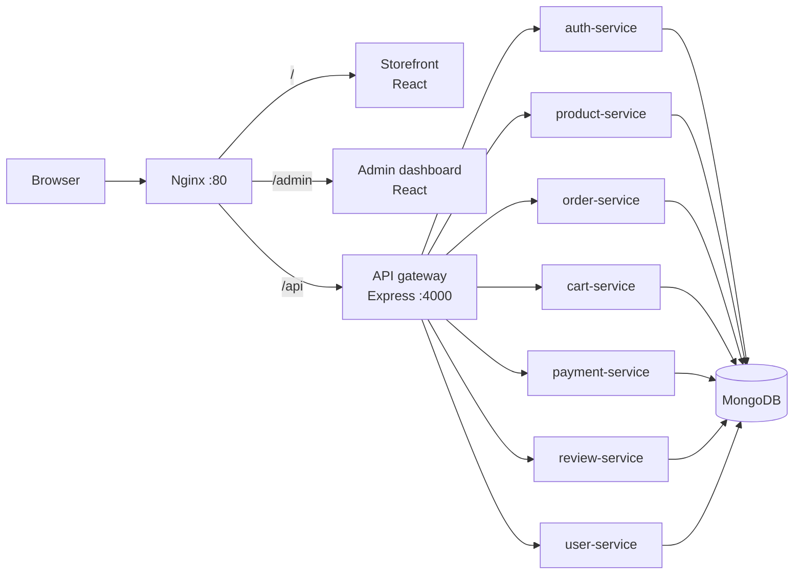

# ECB — E-commerce Microservices Boilerplate

[](https://github.com/kmin344/ECB/actions/workflows/ci.yml)

A Dockerized e-commerce starter: seven Node.js services behind an API gateway, a React storefront, a React admin dashboard, and a CLI that scaffolds new services into the stack. The whole stack runs locally with Docker Compose.

## Background

At work I built e-commerce sites for clients in fashion, art, high-end furniture, and food & beverage. Each project started by rebuilding the same pieces: auth, catalog, cart, orders, payments, an admin panel. This repository is my open-source take on that recurring foundation, structured so a new project starts from working services instead of an empty folder, and so a new domain can be added with one CLI command.

## Architecture



| Component | Stack | Path |
|---|---|---|
| API gateway | Express, http-proxy-middleware | `ecommerce-boilerplate/api-gateway` |
| Services (auth, product, order, cart, payment, review, user) | Express, Mongoose, JWT | `ecommerce-boilerplate/services/*` |
| Storefront | React, Tailwind | `ecommerce-boilerplate/ecommerce-frontend` |
| Admin dashboard | React | `ecommerce-boilerplate/admin-dashboard` |
| Service generator CLI | Node.js, Commander, Inquirer | `ecommerce-boilerplate/cli-tool` |
| Reverse proxy | Nginx | `ecommerce-boilerplate/nginx` |

Services share one MongoDB instance but use separate databases (user-service reads the users that auth-service writes). auth-service issues JWTs, and every other service verifies them itself, so services can be deployed and scaled separately. Only the gateway, the frontends and nginx publish ports; MongoDB and Redis are reachable only inside the Compose network.

## Run it locally

Requires Docker.

```bash
cd ecommerce-boilerplate
docker compose up -d --build
```

- Storefront: http://localhost
- Admin dashboard: http://localhost/admin
- API gateway: http://localhost:4000

`JWT_SECRET` in `docker-compose.yml` is a placeholder for local use. Set a real secret before deploying anywhere.

## Add a new service with the CLI

```bash
cd ecommerce-boilerplate/cli-tool
npm install && npm link   # installs the `ecb` command
cd ..
ecb add-module
```

The CLI asks for a module name, generates an Express service (routes, controller, model, JWT middleware, Dockerfile, a starter test), and registers it in both `docker-compose.yml` and the API gateway. A module named `Wishlist` is served at `/api/wishlists`.

## Tests

- **Service tests** (run in CI on pull requests and pushes to `main`), going through the real routes and JWT middleware with signed tokens; only the Mongoose models are mocked:
  - cart-service: cart operations scoped to the user in the token
  - user-service: role-based access (users manage only their own account; listing, creating, deleting and changing roles is admin-only)

  ```bash
  cd ecommerce-boilerplate/services/cart-service   # or user-service
  npm ci && npx jest
  ```

- **Smoke test** (full stack): through the gateway, registers and logs in a user, creates, lists and partially updates a product, checks stock, places and reads back an order, adds to the cart, and confirms unauthenticated requests are rejected. Each step asserts the status code and response. Start the stack first, then:

  ```bash
  cd ecommerce-boilerplate
  npm ci && npm run test:smoke
  ```

  The same smoke test runs in GitHub Actions on demand (Actions → *Smoke test (full stack)* → Run workflow).

## Repository notes

- `ecommerce-boilerplate/admin-dashboard-angular` is an Angular port of the admin dashboard. It is not wired into `docker-compose.yml`; the React dashboard is the one that runs.
- auth, product and order are covered by the smoke test; review and payment have no automated tests yet.
- user-service roles are stored on the user record; promote the first admin directly in MongoDB (`role: "admin"`).
- To load demo products into a running stack: `cd ecommerce-boilerplate && npm run seed`.
- `docker-compose.yml` also starts a Redis container and passes `REDIS_URL` to cart-service, but carts are currently stored in MongoDB; Redis is reserved for a planned cart cache.
- `scripts/scaffold/` holds the shell scripts that generated the initial project skeleton. They are kept for reference only — running them overwrites `ecommerce-boilerplate/`.

## License

[GPL-3.0](LICENSE)
