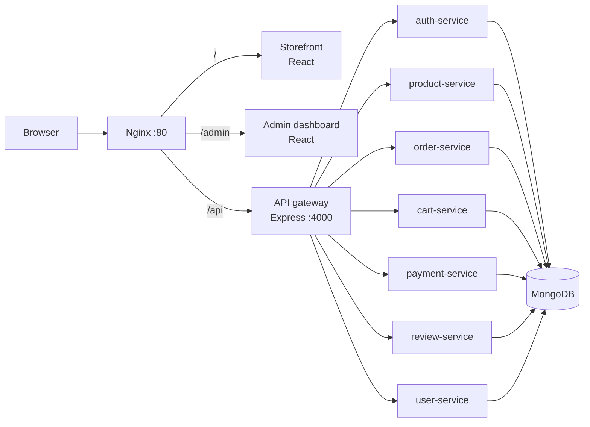

# ECB — E-commerce Microservices Boilerplate

[](https://github.com/kmin344/ECB/actions/workflows/ci.yml)

A Dockerized e-commerce starter: seven Node.js services behind an API gateway, a React storefront, a React admin dashboard, and a CLI that scaffolds new services into the stack. One `docker compose up` brings the whole thing up locally.

## Background

At work I built e-commerce sites for clients in fashion, art, high-end furniture, and food & beverage. Each project started by rebuilding the same pieces: auth, catalog, cart, orders, payments, an admin panel. This repository is my open-source take on that recurring foundation, structured so a new project starts from working services instead of an empty folder, and so new domains can be added with one CLI command.

## Architecture



| Component | Stack | Path |
|---|---|---|
| API gateway | Express, http-proxy-middleware | `ecommerce-boilerplate/api-gateway` |
| Services (auth, product, order, cart, payment, review, user) | Express, Mongoose, JWT | `ecommerce-boilerplate/services/*` |
| Storefront | React, Tailwind | `ecommerce-boilerplate/ecommerce-frontend` |
| Admin dashboard | React | `ecommerce-boilerplate/admin-dashboard` |
| Service generator CLI | Node.js, Commander, Inquirer | `ecommerce-boilerplate/cli-tool` |
| Reverse proxy | Nginx | `ecommerce-boilerplate/nginx` |

Each service owns its own MongoDB database and validates JWTs independently, so services can be deployed and scaled separately. The gateway is the only public entry point for the API.

## Run it locally

Requires Docker.

```bash
cd ecommerce-boilerplate
docker compose up -d --build
```

- Storefront: http://localhost
- Admin dashboard: http://localhost/admin
- API gateway: http://localhost:4000

`JWT_SECRET` in `docker-compose.yml` is a placeholder for local use. Set a real secret before deploying anywhere.

## Add a new service with the CLI

```bash
cd ecommerce-boilerplate/cli-tool
npm install && npm link
cd ..
add-module
```

The CLI asks for a module name and port, generates an Express service with routes, a controller, a model and a Dockerfile, and registers it in `docker-compose.yml`.

## Tests

- **Unit tests** (run in CI on every push): cart-service controller logic, with the database mocked.

  ```bash
  cd ecommerce-boilerplate/services/cart-service
  npm ci && npx jest
  ```

- **Smoke test** (full stack): registers a user, logs in, and exercises products and orders through the gateway. Start the stack first, then:

  ```bash
  cd ecommerce-boilerplate
  npm ci && npm run test:smoke
  ```

  The same smoke test runs in GitHub Actions on demand (Actions → *Smoke test (full stack)* → Run workflow).

## Repository notes

- `ecommerce-boilerplate/admin-dashboard-angular` is an Angular port of the admin dashboard. It is not wired into `docker-compose.yml`; the React dashboard is the one that runs.
- `docker-compose.yml` also starts a Redis container and passes `REDIS_URL` to cart-service, but carts are currently stored in MongoDB; Redis is reserved for a planned cart cache.
- `scripts/scaffold/` holds the shell scripts that generated the initial project skeleton. They are kept for reference only — running them overwrites `ecommerce-boilerplate/`.

## License

[MIT](LICENSE)
