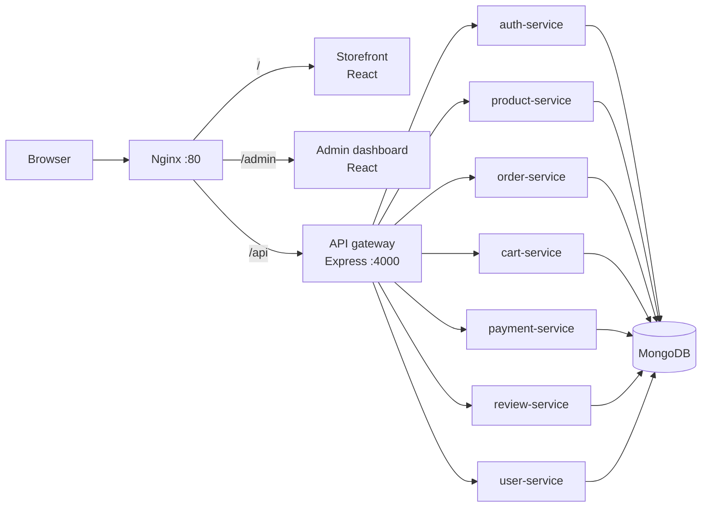

# ECB — E-commerce Microservices Boilerplate

[](https://github.com/kmin344/ECB/actions/workflows/ci.yml)

A Dockerized e-commerce starter: seven Node.js services behind an API gateway, a React storefront, a React admin dashboard, and a CLI that scaffolds new services into the stack. The whole stack runs locally with Docker Compose.

## Background

At work I built e-commerce sites for clients in fashion, art, high-end furniture, and food & beverage. Each project started by rebuilding the same pieces: auth, catalog, cart, orders, payments, an admin panel. This repository is my open-source take on that recurring foundation, structured so a new project starts from working services instead of an empty folder, and so a new domain can be added with one CLI command.

## Architecture



| Component | Stack | Path |
|---|---|---|
| API gateway | Express, http-proxy-middleware | `ecommerce-boilerplate/api-gateway` |
| Services (auth, product, order, cart, payment, review, user) | Express, Mongoose, JWT | `ecommerce-boilerplate/services/*` |
| Storefront | React, Tailwind | `ecommerce-boilerplate/ecommerce-frontend` |
| Admin dashboard | React | `ecommerce-boilerplate/admin-dashboard` |
| Service generator CLI | Node.js, Commander, Inquirer | `ecommerce-boilerplate/cli-tool` |
| Reverse proxy | Nginx | `ecommerce-boilerplate/nginx` |

Services share one MongoDB instance but use separate databases (user-service reads the users that auth-service writes). auth-service issues JWTs, and every other service verifies them itself, so services can be deployed and scaled separately. Only the gateway, the frontends and nginx publish ports; MongoDB and Redis are reachable only inside the Compose network.

## Run it locally

Requires Docker.

```bash
cd ecommerce-boilerplate
cp .env.example .env            # set JWT_SECRET, e.g. openssl rand -hex 32
docker compose up -d --build
```

- Storefront: http://localhost
- Admin dashboard: http://localhost/admin
- API gateway: http://localhost:4000

Every service refuses to start without `JWT_SECRET`, and Compose stops with an error if `.env` does not set it.

### First admin

Only admins can create, change or delete products. To make the first admin:

```bash
# 1. Register the account in the storefront, or:
curl -s localhost:4000/api/auth/register -H 'content-type: application/json' \
  -d '{"username":"owner","email":"owner@example.com","password":"a-long-password"}'
# 2. Give it the admin role
docker compose exec auth-service node scripts/promote-admin.js owner@example.com
# 3. Log in again (the role is put into the token at login)
```

## Add a new service with the CLI

```bash
cd ecommerce-boilerplate/cli-tool
npm install && npm link   # installs the `ecb` command
cd ..
ecb add-module
```

The CLI asks for a module name, generates an Express service (routes, controller, model, JWT middleware, Dockerfile, a starter test), and registers it in both `docker-compose.yml` and the API gateway. A module named `Wishlist` is served at `/api/wishlists`.

## Tests

- **Service tests** (run in CI on pull requests and pushes to `main`), going through the real routes and JWT middleware with signed tokens; only the Mongoose models are mocked:
  - cart-service: cart operations scoped to the user in the token
  - user-service: own-profile routes and role-based access (listing, creating, deleting and changing roles is admin-only)
  - order-service: customers see only their own orders; listing all orders and changing status is admin-only
  - review-service: moderation (admin list, approve/reject, delete) and hiding rejected reviews from the storefront
  - product-service: related products; public reads, admin-only changes, rejected forged and unsigned tokens
  - auth-service: input checks, query-operator rejection, role never taken from the request, same answer for wrong password and unknown email
  - api-gateway: the sign-in rate limit

  ```bash
  cd ecommerce-boilerplate/services/order-service   # or another service, or api-gateway
  npm ci && npx jest
  ```

- **Smoke test** (full stack): through the gateway, registers and logs in a user, creates, lists and partially updates a product, checks stock, places and reads back an order, adds to the cart, and confirms unauthenticated requests are rejected. Each step asserts the status code and response. Start the stack first, then:

  ```bash
  cd ecommerce-boilerplate
  npm ci && ADMIN_EMAIL=owner@example.com ADMIN_PASSWORD=a-long-password npm run test:smoke
  ```

  The same smoke test runs in GitHub Actions on demand (Actions → *Smoke test (full stack)* → Run workflow).

## Repository notes

- `ecommerce-boilerplate/admin-dashboard-angular` is an Angular port of the admin dashboard. It is not wired into `docker-compose.yml`; the React dashboard is the one that runs.
- auth, product and order are covered by the smoke test; payment has no automated tests yet.
- Roles are stored on the user record and included in the JWT that auth-service signs, so order-service and review-service can check for admins without reading the users database. After changing a role, the user has to log in again. See "First admin" above.
- Each service owns its data, so orders and reviews reference users and products by ID; the admin dashboard shows those IDs.
- Orders: order-service ignores any total the client sends. It asks product-service to reserve stock and uses the prices it returns (stored on each order line). Each product's stock is taken with one atomic MongoDB update that matches only while enough stock is left, so concurrent orders cannot oversell; if one line is short, the lines already taken are given back and the order fails with `409`. Cancelling (admin, or the customer while the order is `pending`, via `POST /api/orders/:id/cancel`) returns the stock once. Status rules: `cancelled` and `delivered` are final, and `shipped` can only become `delivered`. Admins can edit only the shipping address and can delete only cancelled orders.
- product-service's `/internal/reserve` and `/internal/release` accept only service tokens (`role: "service"`, signed with `JWT_SECRET`), and the gateway does not route any `/internal` path.
- Limits: MongoDB transactions are not used (they need a replica set). If order-service stops between taking stock and saving the order, that stock is not returned automatically; the log names the order and items.
- The storefront keeps the cart in the browser (Redux); cart-service exposes the same operations as an API.
- Payments are simulated: payment-service marks a payment as succeeded or failed at random, and checkout does not call it yet.
- To load demo products into a running stack: `cd ecommerce-boilerplate && ADMIN_EMAIL=... ADMIN_PASSWORD=... npm run seed`.
- The per-service `scripts/seed.js` files delete their collection before they insert demo data (the auth seed adds `admin@example.com` with a known password). They refuse to run when `NODE_ENV=production`.
- Security: catalog reads and reviews are public; everything else needs a token. Sign-in and registration are rate limited at the gateway (20 per 15 minutes per IP, `AUTH_RATE_LIMIT`). Server errors return a generic message; details go to the service log.
- `docker-compose.yml` also starts a Redis container and passes `REDIS_URL` to cart-service, but carts are currently stored in MongoDB; Redis is reserved for a planned cart cache.
- `scripts/scaffold/` holds the shell scripts that generated the initial project skeleton. They are kept for reference only — running them overwrites `ecommerce-boilerplate/`.

## License

[GPL-3.0](LICENSE)
